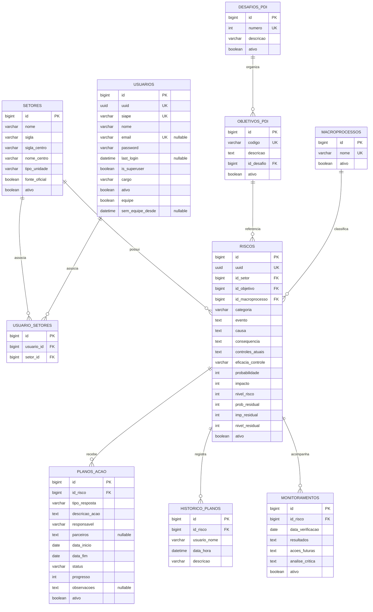

# Banco de dados

Este documento descreve o esquema atual das entidades da aplicação, conforme os models e migrations Django. Os nomes de tabelas e colunas abaixo refletem os nomes usados pelo ORM; o tipo físico pode variar entre SQLite (desenvolvimento/testes) e DB2 (produção).

## Modelo entidade-relacionamento

`PK` indica chave primária, `FK` chave estrangeira e `UK` campo único.

## Entidades e regras

- **Setores e usuários:** relacionamento muitos-para-muitos por `usuario_setores`; um risco pertence a um setor.
- `setores` possui restrição única composta por `(nome, sigla_centro, tipo_unidade)`; `usuario_setores` impede duplicar o mesmo vínculo entre usuário e setor.
- **Estrutura estratégica:** cada objetivo pertence a um desafio PDI; cada risco referencia um objetivo e um macroprocesso.
- **Risco:** `nivel_risco` é calculado como `probabilidade × impacto`; `nivel_residual`, como `prob_residual × imp_residual`.
- **Tratamento e acompanhamento:** um risco pode ter vários planos de ação, registros de histórico e monitoramentos. `historico_planos.usuario_nome` é texto, não uma chave estrangeira para `usuarios`.
- **Ativação e exclusão:** `ativo` indica o estado operacional; usuários e as entidades de risco implementam exclusão lógica. Setores também podem ser desativados pela API.
- **Recuperação de senha:** não há tabela de códigos ou tokens; o fluxo usa token temporário assinado pelo Django.

## Tabelas auxiliares do Django

Além das entidades de domínio acima, o projeto usa tabelas de infraestrutura: `django_migrations`, `django_content_type`, `django_session`, `django_admin_log`, `auth_group`, `auth_permission`, `auth_group_permissions`, `usuarios_groups`, `usuarios_user_permissions` e `authtoken_token`. As tabelas `usuarios_groups`, `usuarios_user_permissions` e `auth_group_permissions` são tabelas de junção de permissões; `authtoken_token` guarda os tokens de autenticação dos usuários.

## Bancos por ambiente

- **Desenvolvimento:** SQLite persistente no arquivo `dev.sqlite3`.
- **Testes:** SQLite em memória, recriado a cada execução.
- **Produção:** conexão com o DB2 institucional já existente; o Docker Compose não provisiona um banco.

O perfil de produção exige `DB_DATABASE`, `DB_HOST`, `DB_PORT`, `DB_USERNAME`, `DB_PASSWORD` e `DB_SCHEMA`, além de `SECRET_KEY` e `ALLOWED_HOSTS`. Configure também `CORS_ALLOWED_ORIGINS` para as origens autorizadas do frontend. Esses valores devem ser fornecidos pelos administradores do ambiente e mantidos fora do repositório.

## Criação e carga de dados

O Django ORM cria e altera tabelas por meio das migrations versionadas em `src/usuarios/migrations/` e `src/riscos/migrations/`. Para preparar um banco vazio, execute `python manage.py migrate`; não execute `makemigrations` na inicialização/deploy, pois esse comando deve ser usado durante alterações de modelos e as novas migrations devem ser versionadas.

As migrations de dados também inserem as referências iniciais: `riscos.0003_seed_pdi_inicial` carrega desafios, objetivos e macroprocessos do PDI; `usuarios.0005_popular_unidades_oficiais_ufsm` importa as unidades do CSV versionado. Para importar ou atualizar desafios e objetivos do PDI a partir dos CSVs em `backend/database/`, execute `python manage.py importar_pdi`. Os caminhos podem ser substituídos com `--arquivo-desafios` e `--arquivo-objetivos`; a importação não remove registros ausentes dos arquivos. O comando `seed_apresentacao` é separado e destrutivo para dados de usuários/riscos, portanto serve somente a bancos locais descartáveis.
